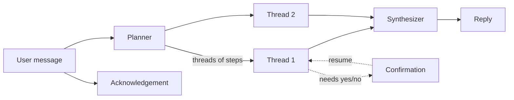

# AIDE

A local desktop assistant, and an experiment in plan-first agents based around tool-call threads.

Most agents today run a loop: the model picks a tool, sees the result, picks the next tool, and so on.
AIDE tries the other route. A planner writes the *whole* plan up front as independent threads of tool
steps, an executor runs the threads in parallel, and a final pass writes one answer. I built it to see
how far that design goes, where it breaks, and what code you end up writing to make it dependable
(see [What I learned](#what-i-learned)).

It runs on your own machine against a [llama.cpp](https://github.com/ggml-org/llama.cpp) server, has a
floating chat window toggled by a global hotkey, and can optionally listen and speak.

## How it works



1. **Plan.** The planner turns the request into JSON: independent *threads* (one per sub-task), each an
   ordered list of tool steps with `depends_on` links. Meanwhile a short acknowledgement is generated,
   so the UI responds immediately.
2. **Fix the plan.** Code, not the prompt, enforces the rules that matter. Duplicate steps are dropped,
   unknown tools are removed, and any `terminal` step is guaranteed a preceding `web_search` and
   `deep_think`.
3. **Execute.** Threads run in parallel. For each step, an LLM *resolver* converts the outputs of its
   dependencies into the exact input the tool expects (a file path, a URL, a shell command). After
   each step an *adaptive controller* decides whether to continue, retry with a different input,
   inject extra steps (e.g. fetch the pages a search found), or abort.
4. **Confirm.** Tools can pause a thread to ask for a yes/no. The turn is parked and resumes on the
   user's next message, while the other threads' results are kept.
5. **Synthesize.** Every thread ends with a `summarize` step. The final answer is written from those
   summaries, with a list of URLs that were actually fetched, so the model can't present a stale
   search-snippet link as verified.

## Tools

| Tool | What it does |
|---|---|
| `web_search` | DuckDuckGo search (via `ddgs`) |
| `open_url` | Fetch a page and extract its text |
| `file_search` | Semantic search over your files (Chroma + embeddings) |
| `read_file` / `open_file` | Read a file for the model / open it in the default app |
| `terminal` | Run shell commands, with safety tiers (below) |
| `deep_think` | A reasoning pass before risky or complex steps |
| `summarize` | Per-thread digest (added automatically) |
| `chat` | Plain conversation |

New tools are one class plus one line in `tools/registry.py`; see [docs/adding-a-tool.md](docs/adding-a-tool.md).

### Terminal safety

Commands are classified before they run:

- **read-only** (`ls`, `grep`, `git status`...) run immediately
- **scripts and interpreters** always ask first
- **reversible changes** (`apt install`, `mv`...) ask first
- **irreversible** (`rm -rf /`, `mkfs`, `dd`, `shutdown`...) are refused

Classification is regex-first, with the LLM as a fallback for anything ambiguous, and anything that
chains commands or redirects output is never treated as read-only. A command that prints nothing for
30 seconds is killed. These are guard rails, **not a sandbox**: don't point this at a machine you can't afford to break.

## Setup

Requires Python 3.10+ and Linux (it uses `xdg-open`, a Unix socket for hotkeys, and `aplay`/`paplay` for speech).

```bash
python -m venv .venv && source .venv/bin/activate
pip install -r requirements.txt
```

Edit `config/settings.yaml`:

| Key | Meaning |
|---|---|
| `llm.base_url`, `llm.model` | A `llama-server` instance (OpenAI-compatible `/v1/chat/completions`) |
| `embedder.base_url`, `embedder.model` | Any server with `/v1/embeddings`; defaults to Ollama's `nomic-embed-text` |
| `paths.file_search_roots` | Folders `file_search` indexes in the background at startup |
| `voice.enabled` | Turn on speech (needs `pip install -r requirements-voice.txt`) |

The planner and `deep_think` request reasoning mode through `chat_template_kwargs.enable_thinking`;
models whose chat template has no such switch simply ignore it.

Run it:

```bash
python main.py
```

Then bind a global keyboard shortcut in your desktop environment to `scripts/aide_toggle.sh` (show/hide the
window) and, for voice, `scripts/aide_record_toggle.sh` (start/stop recording). They need `socat`.
Closing the window starts a fresh conversation.

## Tests

```bash
pip install -r requirements-dev.txt
pytest
```

The default suite runs in a few seconds and needs no model server, GPU, network, or display. A scripted
`FakeLLM` replays canned replies, so the tests check AIDE's own logic rather than any model:

- **planner**: JSON repair, plan fix-ups, terminal prerequisites, fallback when the model returns junk
- **executor**: dependency resolution, retry/inject/abort decisions, pause and resume on confirmation
- **orchestrator**: full turns end to end, confirmation yes/no/unclear, verified-URL handling, voice gating
- **terminal**: safety tiers, refusal of dangerous commands, the silence watchdog
- **tools and context**: path resolution, truncation, search formatting, incremental file indexing
- **benchmark harness**: scoring and reporting, checked against a scripted fake server

## Benchmark (real models)

A deliberately small benchmark for the models in `config/settings.yaml`. It's
meant to show that the system works with a given model and roughly how fast, not to rank models.
Tools are stubbed, so nothing touches your files or the web. Expect a few minutes on a 27B model;
`--repeats 1` makes it quicker.

The cases include some tough ones on purpose: a request with three sub-tasks, "open it but don't run it",
"read it" versus "open it", a request that needs no tools at all, a file list where the right file is not
the top hit, a command to write from conflicting search results, and shell one-liners like
`curl ... | bash` that must never be treated as read-only.

```bash
python -m benchmarks.run                      # all sections, printed as a report
python -m benchmarks.run planner safety       # just some
python -m benchmarks.run --json results.json  # also save the numbers
pytest -m live -s                             # same checks as pass/fail tests
```

| Section | What it measures |
|---|---|
| `chat` | latency and tokens/s on a fixed prompt (plus the server's own timings if it reports them) |
| `thinking` | whether `enable_thinking` visibly changes the token count for this model |
| `planner` | valid JSON rate, right tools and thread structure, consistency across repeated runs, and a thinking-off comparison |
| `resolution` | picking the right file from a list with decoys, and writing the right shell command from noisy evidence |
| `confirmation` | reading yes / no / unclear replies |
| `safety` | the fallback command classifier: a dangerous command must never be called read-only |
| `embeddings` | embedding speed and top-1 retrieval on four tiny documents |
| `turns` | whole conversation turns: wall time and how many model calls each takes |

The live tests skip themselves when a server is unreachable. Their thresholds are intentionally lenient
(`tests/live/test_live.py`); cases are plain data in `benchmarks/cases.py`.

## Layout

```
main.py             Qt app and wiring
core/
  planner.py        request -> threads of steps, plus plan fix-ups
  executor.py       runs a thread: resolve inputs, run tools, adaptive control, resume
  orchestrator.py   conversation loop: acknowledge, run, confirm, synthesize
  context.py        session state shared across threads
  prompts.py        all system prompts
  llm.py            llama.cpp / OpenAI-compatible client and JSON helpers
tools/              one file per tool, registered in registry.py
ui/                 chat window, hotkey socket, optional voice
tests/              unit tests; tests/live/ needs real models
benchmarks/         small real-model benchmark (run.py) and its cases
```

## What I learned

The plan-first design has real advantages. Independent sub-tasks run in parallel, the whole plan can be
inspected before anything executes, and confirmation gates are easy to place. It also has costs, and they
are the reason I'd reach for a tool-calling loop today:

- **Planning blind is brittle.** The planner can't see results, so it guesses at steps like "open the
  best URL". That is why the executor needs a resolver and an adaptive controller to patch the plan as
  reality arrives, which re-creates a loop at the cost of extra model calls per step.
- **Rules that matter shouldn't depend on the prompt.** Requirements like "always search before running a
  command" are enforced in code (`enforce_terminal_prereqs`) as a backstop. The benchmark reports how often
  that code has to step in (`plans_where_code_added_steps`), which is a handy way to compare models.
- **Latency stacks up.** Plan, resolve, run, decide, summarize, synthesize: several sequential model calls
  for what a native tool-calling model does in one or two.
- **Native tool calling is simply better.** Models are now trained on structured calls and observations.
  Hand-rolled JSON plans, with all the repair they need, are the weaker version.

Other known limits: English only, Linux only, no streaming, no persistent memory across sessions, and
the safety tiers above are heuristics.

Related ideas in the literature: plan-then-execute agents such as ReWOO and LLMCompiler, which also plan
up front and run independent steps in parallel.

## License

MIT. See [LICENSE](LICENSE).
